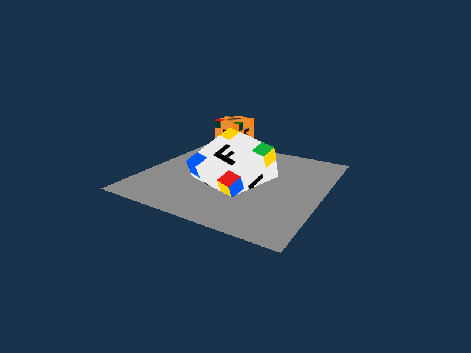
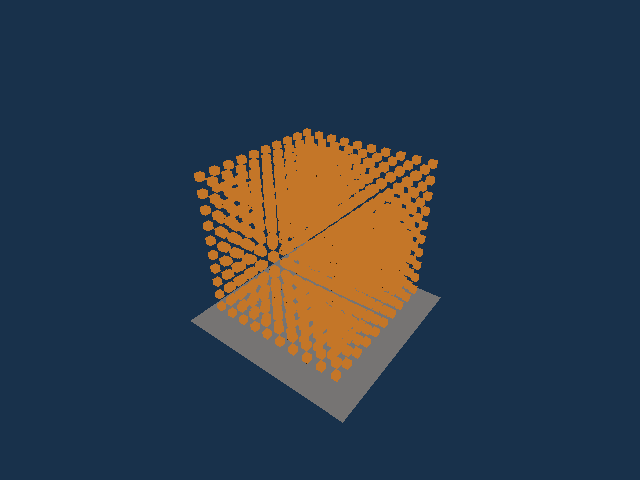
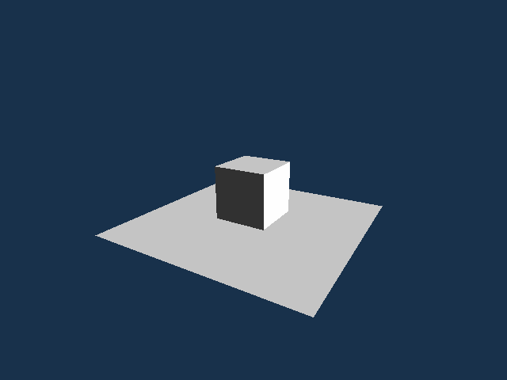
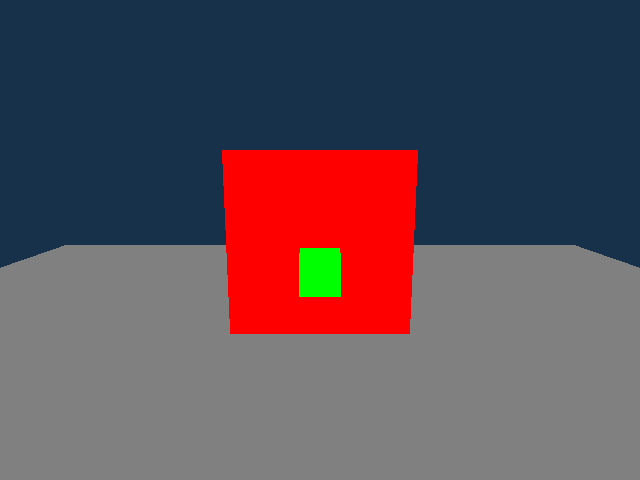

# Simple 3D Engine

[](https://github.com/alken1t15/simple-3d-engine/actions/workflows/build.yml)
[](https://github.com/alken1t15/simple-3d-engine/actions/workflows/documentation.yml)
[](https://github.com/alken1t15/simple-3d-engine/actions/workflows/spikes.yml)
[](LICENSE)
[](global.json)

Учебный проект: небольшой **3D-графический движок на C#** с публичным API. Реализованы CPU-модели сцены (#7), процедурные примитивы (#8), OpenGL-рендер с освещением (#9), PNG-текстуры с GPU-кэшем (#10), JSON собственной сцены (#25) и Demo #11 со сценариями MVP, света C и сохранения/загрузки D. Нагрузочные замеры и финальная приёмка на целевом стенде остаются отдельными задачами.

[Доска задач](https://github.com/users/alken1t15/projects/1) · [План разработки](project_plan.md) · [Правила участия](CONTRIBUTING.md)



*Скриншот отдельного [эксперимента OpenTK (spike #5)](docs/spikes.md): проверка текстуры и отрисовки сцены. Код эксперимента находится в `spikes/`; это не демонстрация готового движка.*

## Сцены в движении

Кадры renderer из [PR #36](https://github.com/alken1t15/simple-3d-engine/pull/36), записанные на версии `4adc4fdb`. Основой служат [графические тесты этой версии](https://github.com/alken1t15/simple-3d-engine/blob/4adc4fdb1b902ffb24d13ccfb8b5aab17b93f578/tests/Engine3D.Tests/SceneRendererTests.cs): для GIF к тестовым сценам добавлено плавное движение камеры или направления света.

### 1000 кубов с общим мешем



Камера облетает сетку 10 × 10 × 10. Все кубы используют один `MeshData`; плоскость — отдельный меш. Сцена основана на тесте GPU-кэша `Shared_mesh_has_one_GPU_mesh_until_Dispose`.

### Направленный свет



Направление света плавно меняется вокруг куба: яркость граней и плоскости зависит от их нормалей, фоновый свет остаётся постоянным. Основа — `Light_direction_changes_brightness_of_cube_faces_and_plane`.

### Перекрытие по глубине



Зелёный куб добавлен в сцену первым, красный — позже. При движении камеры ближний объект продолжает перекрывать дальний благодаря depth test. Основа — `Nearer_object_covers_farther_one_and_cube_with_plane_is_shown`.

*GIF записаны в Linux (Ubuntu/WSL, Xvfb, программный OpenGL), 640 × 480. Скорость воспроизведения задана при сборке роликов и не является замером FPS или подтверждением производительности на целевой видеокарте.*

## Структура solution

`Engine3D.sln` содержит ровно четыре проекта:

| Проект | Назначение | Ссылки на проекты |
|---|---|---|
| `src/Engine3D.Core` | Модель сцены и CPU-данные без окна и OpenGL: `Vertex`, `MeshData`, `TextureData`, `MaterialData`, `Transform`, `Camera`, `Scene`, `SceneLighting` (#7), `PrimitiveFactory` (#8), `SceneSerializer` и `SceneSnapshot` (#25). | Нет |
| `src/Engine3D.OpenGL` | Публичный `Engine` и `EngineOptions` (#9): окно и контекст OpenGL 3.3 через OpenTK, цикл `Run`, GPU-кэш мешей, depth test и базовый свет. `LoadTexture` и GPU-кэш текстур — #10. | `Engine3D.Core` |
| `src/Engine3D.Demo` | Demo #11 на публичном API: вращение и облёт MVP, изменение света C, JSON D и статический показ. | `Engine3D.Core`, `Engine3D.OpenGL` |
| `tests/Engine3D.Tests` | MSTest: CPU-тесты Core, OpenGL-слоя и сценариев/параметров Demo; графические тесты `Engine` по `ENGINE3D_GRAPHICS_TESTS=1`. | `Engine3D.Core`, `Engine3D.OpenGL`, `Engine3D.Demo` |

Все проекты собираются для `net10.0`, с включенными `Nullable` и `ImplicitUsings`. `Engine3D.Core` содержит CPU-модели сцены и JSON-сериализацию на System.Text.Json из .NET, `Engine3D.OpenGL` — рендер на OpenTK 4.9.4 и декодер PNG StbImageSharp 2.30.16. Demo использует только публичный API библиотек, без OpenTK и прямых вызовов OpenGL. Дополнительных проектов и пакетов для Demo нет.

[Контракт API версии 1](docs/api.md) определяет будущие типы, матрицы/UV, нормали, освещение, JSON собственной сцены и примеры A–D. Базовые детали контракта описаны по результатам spike #5; принятые в PR #26 контракты света/JSON сохранены. Наличие документа не означает реализацию функций.

## Сборка и запуск

### Окружение

Целевая ОС для защиты — **Linux**; характеристики выбранного ноутбука записаны в [требованиях](docs/requirements.md#целевой-стенд). Для работы из чистого клона нужны:

- Git для получения исходников.
- [.NET 10 SDK](https://dotnet.microsoft.com/download/dotnet/10.0): `10.0.112` или более новая стабильная версия `10.0.*`. Нужен именно SDK. [global.json](global.json) разрешает новые feature bands внутри .NET 10 (`rollForward: latestFeature`), но исключает preview и переход на другую major/minor-версию.
- Доступ к NuGet для первого восстановления зависимостей; пакеты загружаются командой `dotnet restore`.

Сборка и CPU-тесты не требуют графического окружения. Для Demo и отдельного OpenTK-эксперимента нужны окно и контекст **OpenGL 3.3 core**: драйвер, оконная сессия и системные библиотеки GLFW. Проверен X11; зависимости Linux и особенности WSL описаны в [инструкции spike](docs/spikes.md). Поддержка OpenGL 4.6 на целевом ноутбуке не повышает минимальное требование движка.

### Чистый клон и команды

В новой рабочей папке:

```sh
git clone https://github.com/alken1t15/simple-3d-engine.git
cd simple-3d-engine
dotnet --list-sdks
dotnet --version
dotnet restore Engine3D.sln
dotnet build Engine3D.sln --configuration Release --no-restore
dotnet test Engine3D.sln --configuration Release --no-build
dotnet run --project src/Engine3D.Demo --configuration Release --no-build
```

Если исходники уже получены, выполняйте команды начиная с `dotnet --list-sdks` из корня репозитория. `--no-restore` и `--no-build` используют результаты предыдущих шагов, поэтому порядок команд важен.

Обычный запуск показывает текстурированный куб, второй куб и плоскость. Куб вращается, камера облетает сцену; через 12 секунд видна другая сторона. Проверьте текстуру и перекрытие объектов по глубине. Для завершения закройте окно.

### Сценарии Demo #11

Команды выполняются из корня после сборки. **C — свет:** объекты и камера неподвижны, направление света меняется. **D — JSON:** сцена сохраняется в `artifacts/demo/scene.json`, загружается в новую сцену и показывается неподвижной; существующий файл перезаписывается.

```sh
dotnet run --project src/Engine3D.Demo -c Release --no-build -- --scenario lighting
dotnet run --project src/Engine3D.Demo -c Release --no-build -- --scenario roundtrip
```

Для отдельного сохранения и загрузки: первая команда записывает начальную сцену перед показом, вторая читает её из файла. Сравните положение объектов, текстуру, камеру и освещение.

```sh
dotnet run --project src/Engine3D.Demo -c Release --no-build -- --static --save artifacts/demo/original.json
# Закройте первое окно, затем загрузите файл:
dotnet run --project src/Engine3D.Demo -c Release --no-build -- --load artifacts/demo/original.json
```

JSON хранит примитивы, transform, материалы, камеру и свет. PNG остаётся отдельным файлом; путь к ней записывается относительно каталога JSON. При переносе сцены сохраните расположение текстур или исправьте пути.

Дополнительные параметры (`--texture`, `--scene`, `--frames`) и допустимые сочетания — в справке: добавьте `-- --help` к обычной команде запуска. Ошибки JSON, текстуры или записи файла выводятся с причиной и путём; приложение завершается с кодом 1.

`Engine.LoadTexture(path)` вызывается на потоке `Create`, до `Run`: декодирует PNG в неизменяемую CPU `TextureData` со строками сверху вниз и полным `SourcePath`. Загрузка на GPU ленивая, строки переворачиваются один раз под UV (0, 0) снизу слева. Кэш по идентичности `TextureData`, не по пути: разные материалы с одной ссылкой используют одну GPU-текстуру. Цвет материала умножается на текстуру и свет; alpha игнорируется (непрозрачный материал). Отсутствующий файл, ошибка доступа и поврежденный/неподдерживаемый PNG сообщаются с путем и причиной; другие форматы не поддерживаются.

Для наблюдения кэша запустите графический тест `Shared_texture_is_uploaded_once_changes_are_observed_and_cache_lives_until_dispose`: 1000 разных материалов с одной `TextureData` дают внутренний `Engine.GpuTextureCount == 1`; равная копия дает 2; удаление объектов не освобождает кэш до `Dispose`, после него счетчик 0. `GPU_texture_is_deleted_and_CPU_data_survives` дополнительно проверяет удаление GL-ресурса. Счетчик и GPU-handles не входят в публичный API.

Перед декодированием проверяются границы и CRC-32 PNG-чанков, наличие финального IEND; после декодирования — zlib/Adler-32 данных IDAT. Нечитаемое сообщение декодера заменяется понятным объяснением повреждённого/неподдерживаемого PNG, исходное исключение сохраняется в `InnerException`. Если текстура превышает размер, поддерживаемый GPU, ошибка upload содержит `SourcePath` (либо `<in-memory>`), размеры и лимит устройства.

Текстурные графические тесты на macOS автоматически выполняются в отдельном процессе на главном потоке (требование Cocoa). Для отдельного запуска всех проверок #10 после сборки:

```sh
ENGINE3D_GRAPHICS_TESTS=1 dotnet test Engine3D.sln -c Release --no-build --filter FullyQualifiedName~TextureRenderingTests
```

Либо напрямую на главном потоке: `dotnet tests/Engine3D.Tests/bin/Release/net10.0/Engine3D.Tests.dll texture-smoke`. Это проверка пикселей на реальном контексте, а не замер FPS. Для материалов без текстуры renderer привязывает служебную белую текстуру 1×1 (не входит в счетчик пользовательского кэша), чтобы sampler был полным и на драйвере macOS.

`dotnet test` запускает CPU-тесты без графического контекста: данные меша и текстуры, процедурные куб/плоскость, проверки, матрицы камеры и transform, сцену и свет, а также CPU-часть рендера — проверку опций `Engine`, поправку глубины для OpenGL, подготовку кадра, кэш по идентичности, декодирование PNG и переворот строк для upload, а также сохранение и загрузку сцены в JSON: round-trip, пути текстур, загрузчик и ошибки документа. На Linux он также проверяет в отдельном процессе, что `Engine.Create` на недоступном X11-дисплее каждый раз сообщает понятную причину.

Графические тесты `Engine` открывают небольшие окна и проверяют жизненный цикл, перекрытие по глубине, переиспользование GPU-меша/текстуры, ориентацию UV и свет по пикселям кадра. Им нужны дисплей и драйвер OpenGL 3.3, поэтому без переменной окружения они пропускаются:

```sh
ENGINE3D_GRAPHICS_TESTS=1 dotnet test Engine3D.sln --configuration Release --no-build
```

### Отдельный графический эксперимент

После настройки графического окружения по [инструкции spike](docs/spikes.md) из корня репозитория:

```sh
dotnet run --project spikes/OpenTkSpike --configuration Release
```

Открывается сцена с вращающимися кубами и плоскостью. Закройте окно, чтобы завершить программу. Это эксперимент `spikes/`, а не запуск `Engine3D.Demo`; параметры эксперимента и его собственные smoke-проверки описаны в той же инструкции. Они не заменяют финальную приёмку движка.

### Процедурная геометрия

```csharp
using Engine3D.Core;

var cube = PrimitiveFactory.CreateCube(2f);       // 24 вершины, 12 треугольников
var floor = PrimitiveFactory.CreatePlane(6f, 4f); // XZ, 4 вершины, 2 треугольника
```

Размеры должны быть положительными и конечными, иначе фабрика выбрасывает `ArgumentOutOfRangeException`.
Оба меша центрированы в начале координат. Куб имеет отдельные внешние нормали и UV на каждой грани;
плоскость обращена к +Y. UV (0, 0) снизу слева, обход треугольников — CCW снаружи, как в spike #5.
Фабрики сохраняют внутреннее описание типа и размеров: по нему `SceneSerializer.Save` (#25) записывает
примитив в JSON. На предельно малых float-размерах половина размера может округлиться в ноль:
геометрия тогда вырождается, как допускает `MeshData`, но UV, нормали и описание размеров сохраняются.

### Проверки в CI

GitHub Actions на `push` и `pull_request` проверяет документы и выполняет:

```sh
dotnet restore Engine3D.sln
dotnet build Engine3D.sln --configuration Release --no-restore
dotnet test Engine3D.sln --configuration Release --no-build
```

Отдельный job повторяет тесты с `ENGINE3D_GRAPHICS_TESTS=1` на виртуальном дисплее Xvfb с программным OpenGL Mesa (llvmpipe). Это проверка поведения и пикселей кадра, а не FPS или картинки на целевом GPU.

## Что планируется

- Сцена с несколькими объектами, камерой и преобразованиями `position / rotation / scale`.
- Простая полигональная геометрия: индексные треугольники, куб и плоскость.
- Отрисовка с корректной глубиной, базовым материалом и одной текстурой по UV.
- Фоновый свет и один направленный источник с рассеянной составляющей.
- Сохранение и загрузка собственной сцены в JSON, без импорта внешних моделей.
- Отдельное демо, которое использует публичный API без прямых вызовов OpenGL.
- Нагрузочная сцена примерно из 1000 простых объектов с воспроизводимым замером FPS.

Игровая логика, физика, коллизии и редактор сцен не входят в базовый объем. Точный статус каждого требования и граница MVP записаны в [плане](project_plan.md).

### Ограничения и обязательные функции

Импорт сторонних моделей не требуется: базовая геометрия — процедурные куб и плоскость. Самостоятельная система анимации и culling относятся к дополнительным возможностям. **Простое освещение и сохранение/загрузка собственной сцены в JSON обязательны** (P0-10/11); их показ доступен в режимах `lighting` и `roundtrip`. Вращение объектов в callback приложения не означает реализации отдельной системы анимации.

## Подготовка к защите

Можно показать структуру четырёх проектов и направление зависимостей, выполнить сборку/тесты, объяснить CPU-модель и фабрики, затем запустить режимы Demo A/C/D по командам выше. Отдельный spike и GIF из PR #36 имеют собственное происхождение и не подменяют показ текущего Demo. Финальная приёмка и нагрузочный сценарий B остаются отдельными задачами.

Сценарии основаны на [требованиях A–D](docs/requirements.md) и [контракте API](docs/api.md):

| Сценарий | Что показать | Команда или оставшаяся задача |
|---|---|---|
| A — базовая сцена | Текстурированный куб рядом с плоскостью, преобразования объектов и изменение положения камеры через публичный API. | Запуск Demo без параметров; приёмка на целевом стенде — #13. |
| B — нагрузка | Около 1000 простых объектов; 10 с прогрева и не менее 60 с замера. Записать число объектов/треугольников, разрешение, VSync, фактические FPS/frame time, просадки и память на целевом стенде. | Воспроизводимая performance scene #14 и графический Demo. GIF не являются замером. |
| C — свет | Фоновый и один направленный источник; изменение яркости граней при смене направления, включая неравномерный масштаб. | `--scenario lighting`; приёмка на целевом стенде — #13. |
| D — JSON | Сохранить собственную сцену, загрузить в новую, сравнить геометрию, transform, материалы, камеру и свет; проверить ошибки. | `--scenario roundtrip`, сравнение `--static --save` с `--load`; приёмка на целевом стенде — #13. |

Финальный smoke checklist готовится в [задаче #13](https://github.com/alken1t15/simple-3d-engine/issues/13). После её выполнения здесь появится ссылка на него. Финальная проверка README на чистом клоне с полными P0-10/11 остаётся частью [задачи #15](https://github.com/alken1t15/simple-3d-engine/issues/15).

## Документы

| Документ | Назначение |
|---|---|
| [План разработки](project_plan.md) | Единый рабочий документ: требования, этапы, MVP, роли, риски и критерии готовности. |
| [Требования](docs/requirements.md) | Выбранный P0, отложенные функции, базовые сценарии A/B и расширения C/D. |
| [Архитектура](docs/architecture.md) | Модули, зависимости, модель данных, жизненный цикл и владение ресурсами. |
| [Контракт API v1](docs/api.md) | Типы, lifecycle, матрицы/UV, свет, JSON и клиентские примеры A–D для будущей реализации. |
| [Псевдокод разработки](docs/implementation_outline.md) | Последовательность работ внутри модулей без реализации движка. |
| [Командная работа](docs/team.md) | Зоны ответственности и таблица для фактического состава. |
| [Процесс разработки](docs/development-process.md) | Задачи, PR, человеческое ревью, CI и учет сторонних ассетов. |
| [GitHub Project](docs/github-project.md) | Рекомендуемые поля доски, labels и набор issues для Project. |

## Текущий статус

- [x] Согласованы рабочие требования и границы проекта.
- [x] Составлены план, P0, архитектура, API и псевдокод.
- [x] Проверен OpenTK на целевом стенде ([результаты spike #5](docs/spikes.md)).
- [x] Создан C# solution из четырех проектов и добавлен build/test CI.
- [x] Описан базовый контракт v1 по задаче #6 с сохранением принятых света/JSON из PR #26.
- [x] Реализованы CPU-модели Core и их тесты (#7).
- [x] Реализованы процедурные куб/плоскость с UV, нормалями и CPU-тестами (#8).
- [x] Реализован базовый OpenGL-рендер: `Engine`, окно и цикл, GPU-кэш мешей, depth test и свет, с CPU- и графическими тестами (#9).
- [x] Реализованы сохранение и загрузка собственной сцены в JSON с CPU-тестами (#25).
- [x] Реализовано Demo #11: MVP, изменение света C и JSON D на публичном API, с CPU-тестами сценариев и параметров.
- [ ] Завершены функциональные проверки (#12) и графическая приёмка MVP на целевом стенде (#13).
- [ ] Проведены нагрузочные замеры и финальная проверка.

Следующие шаги — графическая приёмка на целевом стенде (#13), нагрузочная сцена и замеры (#14), финальная проверка запуска (#15). Успешная сборка не означает выполнение этих проверок.

## Участие

До параллельной разработки зафиксировать формат данных и жизненный цикл API; далее работать через небольшие задачи и pull request. Правила ревью и проверок — в [процессе разработки](docs/development-process.md). Публичные изменения в API должны сохранять сценарии A–D из [требований](docs/requirements.md).

## Права

Исходный код и документация проекта распространяются по [MIT License](LICENSE). Перед добавлением внешних моделей, текстур или библиотек записывать источник и лицензию в [THIRD_PARTY.md](THIRD_PARTY.md).
