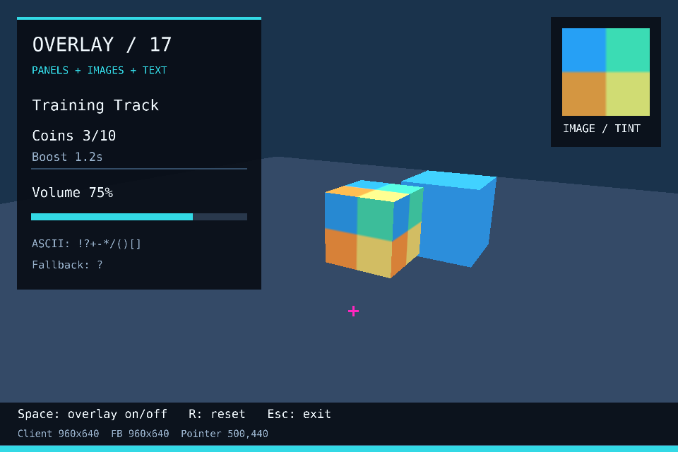
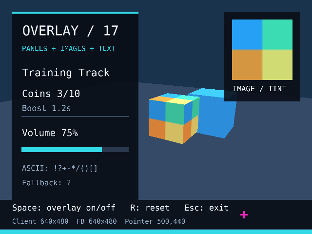

# Проверки overlay

Контракт — [overlay.md](overlay.md); задача —
[simple-platformer#17](https://github.com/alken1t15/simple-platformer/issues/17).
CPU/CI и синтетический X11-прогон не заменяют ручную читаемость и физический HiDPI.

## Сборка и автоматические проверки

```sh
dotnet restore Engine3D.sln
dotnet build Engine3D.sln -c Release --no-restore
dotnet test Engine3D.sln -c Release --no-build
ENGINE3D_GRAPHICS_TESTS=1 dotnet test Engine3D.sln -c Release --no-build
dotnet build samples/OverlaySample -c Release
dotnet run --project samples/OverlaySample -c Release --no-build -- --smoke
```

Без графической переменной/дисплея CPU-тесты работают, графические помечаются как skipped.
Для графических проверок нужны OpenGL 3.3 и дисплей; headless запуск — как в существующем CI:

```sh
ENGINE3D_GRAPHICS_TESTS=1 LIBGL_ALWAYS_SOFTWARE=true xvfb-run -a dotnet test Engine3D.sln -c Release --no-build
xvfb-run -a python scripts/check_overlay_x11.py --output-dir artifacts/overlay-tests
```

| Группа | Что проверяет |
|---|---|
| OverlayFrameTests | Копирование коллекций, shared immutable texture, default values/null, цвета, размеры, NaN/Infinity, пустые/внеэкранные элементы |
| OverlayGeometryTests | UV после clipping, logical top-left, painter order, glyph coverage/ASCII/fallback, пробел, экстремальные finite-значения, пустые поверхности |
| OverlayRenderingTests | Цвет/alpha/слои, UV/tint, glyph coverage над image, точный возврат 3D после null, scale 1/2, GL state на первом/повторном/ошибочном проходе, reuse/delete ресурсов и lifecycle SetOverlay |
| check_overlay_x11.py | Pointer marker и Normal cursor через public sample, очистка/возврат, resize/clipping, дополнительный Refresh без onUpdate, выход; опционально WM minimize/restore |

Pixel-тесты используют внутренний readback после композиции. Для цвета внутренних точек
применяется существующий допуск ±2/канал на округление RGBA8; весь снимок между драйверами
побайтово не сравнивается. Тест null сравнивает статическую сцену до/после в одном контексте.
Тест scale=2 проверяет реальный viewport/пиксели при разных размерах logical/framebuffer,
но не конфигурацию DPI конкретного монитора.

## Публичный sample и нативный Linux-прогон

```sh
dotnet run --project samples/OverlaySample -c Release --no-build
dotnet run --project samples/OverlaySample -c Release --no-build -- --still
python scripts/check_overlay_x11.py --window-manager --output-dir artifacts/overlay-tests
```

Space включает/очищает overlay, R сбрасывает вращение, Escape закрывает окно.
Розовый маркер следует logical pointer, курсор остаётся Normal. В sample нет игровых
переходов/кнопок и захвата мыши. Smoke показывает три кадра, не включает capture.
`--trace` выдаёт JSON с размерами, pointer, focus, update и render counters для драйвера.

### Отставание диагностического marker

Marker рисуется из текущего PointerSnapshot без сглаживания/интерполяции, один раз в кадре.
Обычная стрелка — системный cursor. Между snapshot и видимым marker находятся render,
SwapBuffers и композиция рабочего стола. Небольшой пространственный зазор при движении
может быть задержкой показа; замечание о заметном «преследовании» требует сравнения режимов.
Для сравнения запустите:

```sh
dotnet run --project samples/OverlaySample -c Release --no-build -- --no-vsync
```

В заголовке окна показан VSync on/off. По умолчанию он включён; опция меняет только sample.
Она может уменьшить ожидание кадра, но драйвер/композитор могут ограничивать эффект.
Без VSync возможен tearing. Положение не предсказывается и не экстраполируется.

Для повторяемой синтетической диагностики есть две команды:

```sh
python scripts/check_overlay_x11.py --latency-check --output-dir artifacts/overlay-latency
python scripts/check_overlay_x11.py --latency-check --no-vsync --output-dir artifacts/overlay-latency
```

Драйвер выполняет 24 смены позиции и измеряет время до появления marker в X11 front buffer.
Это включает polling/X11 readback и не измеряет физическую мышь, scanout или motion-to-photon.
Выводит median/p95 и сохраняет JSON. Предельного численного критерия для CI здесь нет;
обычный CI выполняет функциональный прогон, а не сравнение задержки на виртуальном дисплее.

Локальное сравнение 05.11.2026 на том же Mint/X11/AMD-стенде, по 24 позиции в каждом режиме:

| Режим sample | Median до marker в X11 buffer | P95 |
|---|---|---|
| VSync on | 63.04 мс | 64.11 мс |
| `--no-vsync` | 4.89 мс | 6.48 мс |

Это показывает влияние режима показа в данном окружении. Показатели получены с синтетическим
XWarpPointer и readback, не являются измерением физической мыши/экрана или FPS.
Режим без VSync прошёл функциональный X11-прогон (marker, null/return, resize, Refresh, exit)
и smoke на 3 кадра; стандартный VSync остаётся включённым по умолчанию.
Пользователь повторно проверил sample с `--no-vsync` и подтвердил, что отставание
marker больше не мешает и поведение корректное.

X11-драйвер требует только стандартный Python, системные libX11/libXtst и собранный sample.
Предпочтителен отдельный тестовый дисплей: драйвер синтезирует Space/Escape, двигает pointer,
меняет размер только своего окна; focus/pointer восстанавливает в finally.
Оконные снимки записываются в указанный output-dir, по умолчанию файлы не создаются.
Pixel-сценарий драйвера рассчитан на X11 TrueColor RGB24/32 и scale=1; HiDPI проверяется ниже.
Без WM minimize/restore отмечается SKIP; не включайте --window-manager в чистом Xvfb без WM.

## Ручные сценарии

Для каждого записать engine SHA, локальные изменения, ОС/backend/GPU/driver, client W/H,
framebuffer W/H, масштаб, действия, PASS/FAIL/SKIP и причину пропуска.

1. Обычное окно: читаются заголовок, `Coins 3/10`, `Volume 75%`, `Boost 1.2s`, пунктуация;
   неизвестный символ становится `?`. Нет полей соседних glyph и зависимости от освещения.
2. 3D продолжает вращаться под полупрозрачной панелью; Space убирает слой полностью,
   повторный Space возвращает; глубина и текстуры кубов остаются правильными.
3. Resize до меньшего/большего размера: панели/текст обрезаются границами окна,
   нижняя полоса следует новому размеру, картинка сохраняет ориентацию.
4. Сворачивание/восстановление несколько раз: без падения/деления на ноль;
   кадры не считаются во время minimize и снова появляются после restore.
5. Alt-Tab/возврат: одно окно, Normal cursor, без захвата; отображение сохраняется.
6. Реальный HiDPI: установить поддерживаемый системой масштаб и подтвердить,
   что framebuffer dimensions отличаются от logical client. Маркер совпадает с pointer
   у четырёх краёв и в центре; размер текста соответствует logical pixels. Повторить resize.
   Изменение только desktop DPI, при котором client=framebuffer, не считать проверкой HiDPI.
7. Запуск из другой cwd через абсолютный путь к собранной DLL: текст и изображение доступны.
8. Несколько запусков/выходов; отдельно автоматические reuse/delete tests. Визуальное
   наблюдение само по себе не доказывает отсутствие GPU-утечек.

HiDPI/Wayland-native, ручная читаемость и FPS не выводятся из зелёного CI.
Статус фактического локального прогона фиксируется после выполнения проверок.

Уточнение для текущего X11-стенда: в GLFW размеры window content area и framebuffer
на X11 всегда соответствуют 1:1. Изменение масштаба рабочего стола не создаёт здесь
сценарий framebuffer≠client. Такой сценарий поддерживается, например, native Wayland
или macOS; он требует соответствующего backend и масштаба. См.
[официальное описание GLFW_SCALE_FRAMEBUFFER](https://www.glfw.org/docs/3.4/window_guide.html#window_hints_wnd).
На текущем Mint/X11 этот частный сценарий отмечается SKIP с причиной backend;
читаемость, pointer, resize, focus и обычный рендер можно проверять вручную сейчас.

## Локальный прогон 05.11.2026

Проверена локальная реализация #17 поверх engine `b20e9ed` в ветке `feature/overlay-17`;
изменения оставлены unstaged, отдельного SHA реализации ещё нет.
Окружение: .NET SDK 10.0.114, Linux Mint 22.1/Cinnamon/X11, AMD Radeon Graphics
(radeonsi, renoir), Mesa 25.2.8, аппаратное ускорение. Client/framebuffer 960×640,
после resize 640×480; scale=1. Это не FPS-замер.

- Restore, Release build solution/sample: PASS, 0 предупреждений/ошибок.
- CPU-набор: 456 PASS, 41 graphics/native SKIP; новые CPU-тесты overlay — 12 PASS.
- Полный graphics-набор: 495 PASS, 2 несвязанных native-audio SKIP;
  новые графические overlay cases — 9 PASS. Scale=2 проверен synthetic viewport test.
- OverlaySample smoke: 3 кадра, Normal cursor, штатный выход — PASS.
- Запуск собранного OverlaySample из другой cwd (`/tmp`): 3 кадра, текст доступен — PASS.
- Существующий native InputSample/X11-прогон: клавиши/Shift, pointer/buttons, capture,
  focus/rearm, exit/reentry и resize — PASS. Это регрессия совместимости общего Engine.
- X11-драйвер с WM: pointer marker, очистка/возврат, resize/clipping, Expose/Refresh,
  minimize/restore и выход — PASS. Focus/pointer восстановлены.
- При отладке драйвера воспроизведено отсутствие restore от одного XMapRaised в Cinnamon;
  драйвер теперь использует запрос EWMH `_NET_ACTIVE_WINDOW`. Это исправление тестового
  управления WM; рендер останавливается по фактическому GLFW Iconified и возобновляется после restore.
- Реальный HiDPI и Wayland-native — SKIP.
- Пользователь выполнил ручной прогон sample и подтвердил обычные визуальные сценарии;
  отдельно отметил отставание розового маркера от системного курсора при движении.
  Искусственного сглаживания в sample нет: marker использует Pointer.Position текущего
  InputSnapshot. VSync включён по умолчанию, позиция видна после рендера и SwapBuffers.
  Затем замечание уточнено как заметное «преследование» при движении; синтетическое сравнение
  VSync on/off приведено выше. Величина физической motion-to-photon задержки не измерена;
  длительное догоняющее движение после остановки указателя не подтверждено.
- Удалённый CI, upstream PR/merge и game gitlink пока не выполнялись.





## Совместная приёмка input/overlay — 05.11.2026

Проверен commit `25a0e1cdb48a4383d469aaf3ab69c95bba2cdd22`,
ветка `feature/overlay-17`, Linux Mint 22.1 / Cinnamon / X11, .NET SDK 10.0.114.
Приведённый выше ранний прогон выполнен до этого commit;
ниже — результаты повторной проверки собранной версии и подтверждение пользователя.

- Solution и оба sample — Release build PASS, 0 warnings/errors.
- Совместные input/overlay/lifecycle tests — **44/44 PASS**, без пропусков,
  включая оба значения scale=1/2 в `Logical_coordinates_scale_once_to_physical_framebuffer`.
- Нативный overlay-прогон с `--no-vsync` — PASS: pixel marker по logical pointer,
  Normal cursor, null/return, clipping/resize, Expose/Refresh без лишнего update,
  minimize/restore через Cinnamon и clean exit.
- Дополнительный локальный X11-драйвер проверил центр и четыре угла при 960×640
  и повторно при 640×480. Pixel readback дожидается отображённого marker,
  а не полагается на фиксированную задержку между warp и чтением пикселя.
- Native input/cursor regression на этом commit — PASS; OverlaySample smoke
  с `--no-vsync` — 3 кадра, штатный выход, CursorMode.Normal.
- Пользователь подтвердил **весь** запрошенный ручной сценарий OverlaySample
  с `--no-vsync`: физическая мышь в центре и у краёв, resize, Space off/on,
  Alt-Tab туда/обратно. Маркер совпадает с указателем, слой сохраняется, курсор свободен.
- Native framebuffer≠client HiDPI — SKIP по ограничению X11, описанному выше;
  GPU scale=2 не обозначается как проверка физического HiDPI-стенда.

Связанный протокол и границы приёмки #16 — [input-testing.md](input-testing.md).
Commit/PR этого отчёта, upstream merge и game gitlink данным прогоном не выполняются;
результат проверки не заменяет эти этапы передачи #17.
